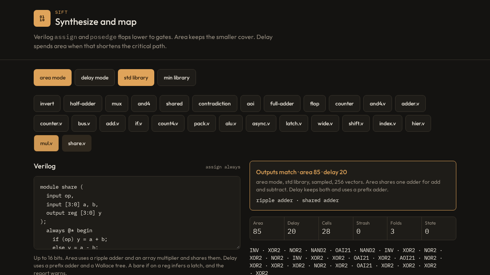

<p align="center">
  
</p>

Sift reads Verilog and maps it onto a standard-cell library. It lowers a module to an AND-inverter graph, covers that graph, and reports area, cell count, and setup slack. The mapped netlist is structural Verilog with no `assign`.

The same functions drive the command line and the bench page. There is no floorplan, no clock tree, and no multi-corner analysis. Wire cost is a model you pass in.

Mohamed Shalan · [mshalan@aucegypt.edu](mailto:mshalan@aucegypt.edu)

## Features

- Verilog subset in, structural Verilog out. `assign`, `always`, `generate`, macros, signed arithmetic, memories, and async reset lower to gates. The mapped netlist has no `assign`.
- AND-inverter graph, then a 4-input area-flow cover. Area mode spends the rewriting on fewer gates. Delay and load mode may take a shallower tree when it does not add gates.
- Three goals. `area` keeps the smallest legal cell. `delay` sizes from a fanout count, still on a unit delay. `load` has the same goal as delay, but each gate's delay is its Liberty NLDM table at the real input slew and output capacitance.
- Libraries. `std` and `min` are unit-delay. `sky130` is a reduced Sky130 HD library. Any Liberty file with an inverter can be the target.
- Adders and multipliers. Ripple and an array multiplier, or Brent-Kung and a Wallace tree. After mapping, each adder is chosen again from the slack at its endpoints. `--ppa` biases that choice.
- Electrical limits in every mode. A driver that misses max capacitance or max transition is upsized, then buffered, then cloned, when the library can meet the load. An explicit max fanout uses the same pass. A miss that cannot be repaired stays in the report.
- Timing. Setup and hold on an ideal clock named `clk`, with period, input and output delay, input slew, output load, clock slew, a Liberty wire-load, or capacitance per fanout. An SDC subset covers the same constraints.
- Area recovery and clock gating, both off unless asked. `--recover` downsizes a cell while setup slack stays non-negative and no limit hit is added. `--gate` replaces a nest of enable muxes with one latch-based clock gate.
- `--opt area` meets the period and then shrinks area. `--opt delay` grows slack. The search changes one free knob at a time, and a knob you set stays fixed.
- Simulation of every output, a JSON report, and `--lec` to prove the netlist against the RTL with Yosys.
- `--propose` and `--crit` mine a repeated cone, or the late path, for one new cell priced from the library NAND2, then remap.
- The same mapper drives the command line and the bench page.

<p align="center">
  
</p>

## Run

Node 22. The command line runs TypeScript directly.

```bash
npm install
npm run sift -- designs/dsp8.v --lib sky130 --mode load --arith delay --period 10 --max-fanout 10
```

`--lib` is `std` (default), `min`, `sky130`, or a Liberty file. `--mode` is `area`, `delay`, or `load`. Load mode times gates from pin capacitance and NLDM tables. `--arith delay` builds Brent-Kung adders and a Wallace multiplier; the default is a ripple adder and an array multiplier. `--ppa N` (0 to 1) biases that choice toward area or delay. Slack still sets each adder's weight: near the period it spends area, near zero it keeps delay. `--recover` spends positive setup slack on a smaller drive. `--gate` replaces a nest of enable muxes with one latch-based clock gate, so a memory word shares one gate. Both stay off unless you ask. `--opt area` meets the period and then shrinks area; `--opt delay` grows slack. It starts from those defaults and changes one free knob at a time. A knob you set stays fixed. `--lec` cannot be combined with `--gate`.

```bash
npm run sift -- top.v leaf.v --top top --lib sky130 --mode load --sdc design.sdc --netlist out.v --timing out.timing
npm run sift -- design.v --lec          # prove the netlist against the RTL with Yosys
npm test
npm run typecheck
npm run dev                             # bench UI
```

Exit status is 0 when every simulated output matches. It is 1 on a syntax error, a mapping error, a mismatch, or a failed `--lec` proof.

`--lec` needs Yosys. The delay bench in `scripts/bench-delay.ts` also needs OpenSTA. Paths can be set with `SIFT_YOSYS`, `SIFT_STA`, `SIFT_SKY130_LIB`, and `SIFT_BENCH_ROOT`.

## Benchmark against Yosys

Each design is mapped once in area, once in delay, and once in load. Arithmetic stays at the default ripple adder and array multiplier. There is no `--opt` search, no clock gating, and no area recovery. Max fanout is 9.

Load mode is the timed cover. Area mode picks the smallest legal cell. Delay mode sizes from a fanout count: a net with more sinks gets a stronger cell, and the cost model is still a unit delay. Load mode has the same goal as delay, but the delay of a gate is read from its Liberty NLDM table at that gate's input slew and the capacitance on its output. On Sky130 that capacitance is the pin caps it drives, since this run has no wire load. Load is the mode whose internal timer matches a real cell table.

All three tables share one Yosys result: `synth -flatten`, `dfflibmap`, then `abc -D 8000`. Same 24 Sky130 HD cells, period 8 ns, input and output delay 0, input slew 0.01 ns, output load one inverter pin (2.302 fF), wires equal to pin capacitance. OpenSTA scores every netlist. Columns are Sift / Yosys. Area is µm², slack and slew are nanoseconds, power is total microwatts, runtime is the mapper only.

### Area

Smallest legal cell. Sift is 1.49× the cells, 1.38× the area, and 1.17× the power (256.0 s against 30.5 s). Yosys is smaller in area on 14 designs, uses fewer cells on 13, and uses less power on 12. Sift has more setup slack on fifo, mem, pwm, pic16, and x18.

| Design | What | Cells | Area µm² | Slack ns | Slew ns | Power µW | Runtime s |
| --- | --- | ---: | ---: | ---: | ---: | ---: | ---: |
| cpu8 | 8-bit CPU, register file, and ALU | 666/693 | 4928.5/4606.9 | 3.419/4.181 | 0.371/0.442 | 506.63/556.68 | 1.79/0.72 |
| dsp8 | 8-bit DSP slice: product, MAC, delay line | 1183/1069 | 7056.8/6535.0 | 1.729/3.522 | 0.483/0.402 | 603.71/584.44 | 2.28/0.87 |
| fir10 | 10-tap 8-bit FIR | 4786/4903 | 29285.6/29907.4 | 0.428/1.596 | 0.234/0.298 | 1917.00/1946.17 | 4.75/1.88 |
| xfir | dual 10-tap inner product | 8698/9081 | 51951.1/53869.2 | −0.073/0.864 | 0.234/0.297 | 2771.70/2845.83 | 14.60/3.99 |
| uart | UART | 308/223 | 2119.5/1680.4 | 6.487/6.534 | 0.315/0.417 | 271.90/273.27 | 1.43/0.34 |
| fifo | four-word FIFO | 286/172 | 1996.9/1686.6 | 6.564/6.182 | 0.365/0.502 | 257.02/247.75 | 0.63/0.23 |
| mem | 16×8 register file | 788/506 | 6145.9/5167.5 | 6.938/6.733 | 0.277/0.502 | 822.25/776.26 | 0.69/0.29 |
| pwm | PWM compare | 27/29 | 182.7/205.2 | 7.269/7.230 | 0.124/0.146 | 24.93/25.50 | 0.25/0.16 |
| lfsr | LFSR | 28/26 | 267.8/240.2 | 7.082/7.253 | 0.156/0.164 | 47.05/45.74 | 0.20/0.11 |
| gray | Gray-code counter | 17/18 | 156.4/158.9 | 7.231/7.241 | 0.165/0.163 | 24.27/24.35 | 0.17/0.12 |
| uart_apb | UART-to-APB master | 2341/1407 | 17879.6/13455.4 | 3.284/5.193 | 0.435/0.413 | 2168.19/1992.72 | 2.82/0.54 |
| risc8 | PIC16C5x-compatible CPU | 6944/3734 | 45180.8/27990.6 | 1.000/2.893 | 0.353/0.423 | 4926.15/4255.25 | 16.07/2.50 |
| pic16 | PIC16C5x, clock port renamed clk | 7383/4074 | 46029.1/31061.0 | 1.824/1.774 | 0.358/0.430 | 5327.97/4768.47 | 12.54/1.91 |
| pic1826 | PIC16F1826-style CPU, ROM and RAM stubbed | 10762/3942 | 71258.3/28901.5 | 1.450/3.403 | 0.407/0.439 | 8172.62/4182.86 | 30.82/1.90 |
| p16c5x | Morris P16C5x, clock port renamed clk | 8881/3665 | 51623.3/32222.2 | 2.424/3.829 | 0.431/0.525 | 5474.81/4666.39 | 13.88/2.44 |
| arlet6502 | Arlet 6502 | 3667/1667 | 20469.6/10163.5 | 0.726/2.997 | 0.816/0.506 | 1481.12/1061.75 | 8.68/1.26 |
| x18 | Arlet X18, program image is the address | 8009/6781 | 55530.8/43889.6 | 3.183/−0.109 | 0.491/0.466 | 5981.65/5572.48 | 37.65/2.65 |
| chacha | memory-mapped ChaCha | 22742/16828 | 148941.6/115718.5 | −13.496/−10.316 | 0.988/0.459 | 14527.59/13457.72 | 106.73/8.59 |
| **18 designs** | | **87516/58818** | **561004.3/407459.5** | | | **55306.56/47283.61** | **256.0/30.5** |

### Delay

Fanout sizing on a unit-delay cost. Sift is 2.26× the cells, 2.14× the area, and 1.51× the power (251.5 s against 30.5 s). Yosys is smaller on every design. Sift has more setup slack on 9 designs, including cpu8, risc8, pic16, p16c5x, x18, and chacha.

| Design | What | Cells | Area µm² | Slack ns | Slew ns | Power µW | Runtime s |
| --- | --- | ---: | ---: | ---: | ---: | ---: | ---: |
| cpu8 | 8-bit CPU, register file, and ALU | 1165/693 | 7093.1/4606.9 | 4.481/4.181 | 0.247/0.442 | 620.77/556.68 | 1.74/0.72 |
| dsp8 | 8-bit DSP slice: product, MAC, delay line | 1982/1069 | 13548.0/6535.0 | 2.572/3.522 | 0.361/0.402 | 937.05/584.44 | 2.59/0.87 |
| fir10 | 10-tap 8-bit FIR | 8943/4903 | 72858.6/29907.4 | 1.146/1.596 | 0.250/0.298 | 4248.26/1946.17 | 5.28/1.88 |
| xfir | dual 10-tap inner product | 16695/9081 | 137967.3/53869.2 | 0.655/0.864 | 0.250/0.297 | 7384.09/2845.83 | 12.10/3.99 |
| uart | UART | 522/223 | 2974.1/1680.4 | 6.623/6.534 | 0.249/0.417 | 307.78/273.27 | 1.17/0.34 |
| fifo | four-word FIFO | 481/172 | 2785.2/1686.6 | 6.575/6.182 | 0.185/0.502 | 293.05/247.75 | 0.56/0.23 |
| mem | 16×8 register file | 1246/506 | 7813.7/5167.5 | 6.869/6.733 | 0.240/0.502 | 912.33/776.26 | 0.81/0.29 |
| pwm | PWM compare | 44/29 | 265.3/205.2 | 7.122/7.230 | 0.167/0.146 | 28.13/25.50 | 0.22/0.16 |
| lfsr | LFSR | 44/26 | 324.1/240.2 | 7.097/7.253 | 0.162/0.164 | 49.40/45.74 | 0.18/0.11 |
| gray | Gray-code counter | 35/18 | 219.0/158.9 | 7.191/7.241 | 0.205/0.163 | 27.05/24.35 | 0.17/0.12 |
| uart_apb | UART-to-APB master | 3683/1407 | 23217.3/13455.4 | 4.711/5.193 | 0.487/0.413 | 2401.77/1992.72 | 3.28/0.54 |
| risc8 | PIC16C5x-compatible CPU | 9145/3734 | 53966.8/27990.6 | 2.979/2.893 | 0.409/0.423 | 5417.07/4255.25 | 16.14/2.50 |
| pic16 | PIC16C5x, clock port renamed clk | 9942/4074 | 58448.6/31061.0 | 3.376/1.774 | 0.461/0.430 | 5909.79/4768.47 | 12.28/1.91 |
| pic1826 | PIC16F1826-style CPU, ROM and RAM stubbed | 13304/3942 | 82720.6/28901.5 | 3.066/3.403 | 0.483/0.439 | 8874.70/4182.86 | 39.69/1.90 |
| p16c5x | Morris P16C5x, clock port renamed clk | 10425/3665 | 60644.4/32222.2 | 4.155/3.829 | 0.407/0.525 | 5923.21/4666.39 | 17.74/2.44 |
| arlet6502 | Arlet 6502 | 5833/1667 | 32108.3/10163.5 | 2.887/2.997 | 0.322/0.506 | 2034.85/1061.75 | 8.56/1.26 |
| x18 | Arlet X18, program image is the address | 11617/6781 | 71722.5/43889.6 | 1.477/−0.109 | 0.497/0.466 | 6863.38/5572.48 | 14.76/2.65 |
| chacha | memory-mapped ChaCha | 37980/16828 | 243638.7/115718.5 | −7.514/−10.316 | 0.483/0.459 | 19369.55/13457.72 | 114.19/8.59 |
| **18 designs** | | **133086/58818** | **872315.4/407459.5** | | | **71602.21/47283.61** | **251.5/30.5** |

### Load

NLDM tables at the real slew and capacitance. Sift is 1.44× the cells, 1.35× the area, and 1.16× the power (258.5 s against 30.5 s). Yosys is smaller in area on 16 designs, uses fewer cells on 16, and uses less power on 15. Sift has more setup slack on fifo, pwm, uart_apb, pic16, x18, and chacha. x18 meets the period. chacha misses on both sides: 8.569 ns for Sift, 10.316 ns for Yosys.

| Design | What | Cells | Area µm² | Slack ns | Slew ns | Power µW | Runtime s |
| --- | --- | ---: | ---: | ---: | ---: | ---: | ---: |
| cpu8 | 8-bit CPU, register file, and ALU | 777/693 | 5622.9/4606.9 | 3.525/4.181 | 0.306/0.442 | 529.04/556.68 | 1.72/0.72 |
| dsp8 | 8-bit DSP slice: product, MAC, delay line | 1300/1069 | 7553.5/6535.0 | 1.889/3.522 | 0.469/0.402 | 623.99/584.44 | 1.67/0.87 |
| fir10 | 10-tap 8-bit FIR | 5736/4903 | 31746.7/29907.4 | 0.565/1.596 | 0.259/0.298 | 2013.70/1946.17 | 9.20/1.88 |
| xfir | dual 10-tap inner product | 10553/9081 | 56963.4/53869.2 | 0.086/0.864 | 0.259/0.297 | 2958.32/2845.83 | 15.12/3.99 |
| uart | UART | 348/223 | 2238.4/1680.4 | 6.456/6.534 | 0.356/0.417 | 279.54/273.27 | 0.97/0.34 |
| fifo | four-word FIFO | 353/172 | 2259.7/1686.6 | 6.333/6.182 | 0.256/0.502 | 270.92/247.75 | 0.48/0.23 |
| mem | 16×8 register file | 949/506 | 6391.1/5167.5 | 6.632/6.733 | 0.362/0.502 | 851.91/776.26 | 0.82/0.29 |
| pwm | PWM compare | 27/29 | 185.2/205.2 | 7.269/7.230 | 0.139/0.146 | 24.96/25.50 | 0.24/0.16 |
| lfsr | LFSR | 28/26 | 267.8/240.2 | 7.082/7.253 | 0.156/0.164 | 47.05/45.74 | 0.18/0.11 |
| gray | Gray-code counter | 17/18 | 156.4/158.9 | 7.231/7.241 | 0.165/0.163 | 24.27/24.35 | 0.17/0.12 |
| uart_apb | UART-to-APB master | 2307/1407 | 18799.3/13455.4 | 5.199/5.193 | 0.368/0.413 | 2177.31/1992.72 | 3.67/0.54 |
| risc8 | PIC16C5x-compatible CPU | 6095/3734 | 41335.9/27990.6 | 2.295/2.893 | 0.468/0.423 | 4788.49/4255.25 | 12.31/2.50 |
| pic16 | PIC16C5x, clock port renamed clk | 7504/4074 | 45277.2/31061.0 | 1.863/1.774 | 0.438/0.430 | 5275.27/4768.47 | 12.52/1.91 |
| pic1826 | PIC16F1826-style CPU, ROM and RAM stubbed | 7042/3942 | 65849.4/28901.5 | 1.860/3.403 | 0.366/0.439 | 7770.73/4182.86 | 37.97/1.90 |
| p16c5x | Morris P16C5x, clock port renamed clk | 7410/3665 | 45760.1/32222.2 | 3.507/3.829 | 0.513/0.525 | 5280.81/4666.39 | 13.24/2.44 |
| arlet6502 | Arlet 6502 | 4105/1667 | 21852.2/10163.5 | 1.548/2.997 | 0.424/0.506 | 1535.70/1061.75 | 7.60/1.26 |
| x18 | Arlet X18, program image is the address | 8102/6781 | 54202.0/43889.6 | 0.137/−0.109 | 0.483/0.466 | 5961.06/5572.48 | 24.19/2.65 |
| chacha | memory-mapped ChaCha | 22298/16828 | 143985.6/115718.5 | −8.569/−10.316 | 0.512/0.459 | 14464.34/13457.72 | 116.44/8.59 |
| **18 designs** | | **84951/58818** | **550446.7/407459.5** | | | **54877.41/47283.61** | **258.5/30.5** |

The full tables are also in [bench/delay/MODES.md](bench/delay/MODES.md). An older `--opt area` search, which can change the adder and turn on a clock gate, is in [bench/delay/REPORT.md](bench/delay/REPORT.md).

## Docs

|                                                    |                                                       |
| -------------------------------------------------- | ----------------------------------------------------- |
| [docs/user-guide.md](docs/user-guide.md)           | Verilog subset, libraries, modes, SDC, reports        |
| [docs/developer-guide.md](docs/developer-guide.md) | Pipeline, AIG passes, cover, timing, how to extend it |
| [bench/delay/MODES.md](bench/delay/MODES.md)       | Area, delay, and load against Yosys                   |
| [bench/delay/REPORT.md](bench/delay/REPORT.md)     | Older `--opt area` search against Yosys and OpenSTA  |

## Layout

```text
src/synth/     mapper, Verilog, Liberty, SDC, equivalence
designs/       larger Verilog sources
docs/          user guide, developer guide, logo
bench/delay/   published delay comparison
```

The bench examples live in `src/synth/examples.ts`. `designs/` holds the larger modules as files the CLI can read. `cpu8`, `dsp8`, `fir10`, and `xfir` are proved against the Verilog by `npm run test:designs`. `uart_apb`, `risc8`, `pic16`, `pic1826`, `p16c5x`, `arlet6502`, `x18`, and `chacha` are on the delay bench. `pic16` and `p16c5x` rename the clock port `Clk` to `clk`. `pic1826` stubs the missing stack, ROM, and RAM. `x18` uses the address in place of the missing program image.

## Limits

- Wires are at most 512 bits. A memory is a local `reg` of at most 128 words and 1024 bits.
- The combinational cloud, including flop outputs treated as inputs, has at most 2048 inputs.
- The clock port must be named `clk`. It is an ideal net: no clock tree and no clock latency. `--gate` adds one integrated clock gate per enable; that delay is per-flop latency, not a clock tree.
- Cuts are 4-input. A pattern seed can be wider. See the user guide for `--propose` and `--crit`.
- Every mode sizes, buffers, or clones a driver that misses max capacitance or max transition, when the library can meet the load. An explicit max fanout uses that same pass. Area mode leaves the implicit fanout of 4 alone. A miss the library cannot repair stays in the report.

## Custom cells

`--propose` mines repeated cones for area and remaps with up to N new cells. `--crit` looks at the late path and tries one cell, then remaps once.

Both price the new cell from the library NAND2, not from a characterized table:

```text
delay = nand.delay * (0.8 + 0.1 * ands)
area  = nand.area  * (0.5 + 0.35 * ands)
```

`nand.delay` is that cell's table at the smallest slew and the smallest load. The cell has drive 1 and no slew table. The timer uses that scalar plus `Cload / drive`. A reported slack is a fresh setup check after the remap. It is not the cover's internal "saved" number. On Sky130 that estimate can be optimistic: a kept cell may not improve slack.

## License

Sift is licensed under the [Apache License 2.0](LICENSE). Copyright 2026 Mohamed Shalan.

Some files in `designs/` are vendored benchmarks and keep the copyright and license in their headers, including GPL and LGPL sources. Those notices win for those files.
